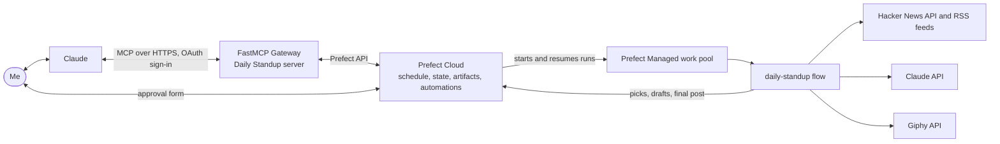

# daily-standup

A bot that reads the morning's tech news and drafts one-line LinkedIn jokes about it, in my voice. It never posts anything. Every morning it leaves a few drafts waiting for me; I pick one, from the Prefect UI or by telling Claude, and it hands me the final text to post myself.

It runs daily, it writes stand-up, and it is named after the meeting.

I built it as a small, complete example of three things working together: a Prefect flow on Prefect Cloud, a FastMCP server on FastMCP Gateway, and Claude as the client.

## What a run looks like

1. At 9:30 AM Pacific, Prefect Cloud starts the flow on Prefect Managed compute.
2. The flow pulls headlines from Hacker News, The Verge, Ars Technica, and TechCrunch.
3. Claude picks the three stories with the best comedic angle: a specific, concrete detail a joke can hinge on.
4. Claude writes three options for the top story, working from a voice guide built on things I actually posted.
5. A voice check drops anything that sounds like LinkedIn: hashtags, takeaways, "Here's the thing", jokes that explain themselves.
6. The flow publishes the drafts and suspends. The container shuts down and nothing is billed while it waits.
7. I approve one, ask for new drafts on the next story, or skip. The flow wakes up and publishes the final post as an artifact.

A real example from a test run, about a nationwide ground stop blamed on a "routine" equipment upgrade:

> Every outage I've ever caused also started as a routine upgrade.

## Architecture



- **Prefect Cloud** is the engine and the system of record. The schedule, the run state, the drafts, the approval, and the final post all live there.
- **The FastMCP server** is a thin layer. It starts runs, reads what the flow published, and sends my reply to a suspended run. It contains no business logic of its own.
- **Claude** is the front end. It shows me the drafts and passes my pick back. It is told never to approve on my behalf.

The approval works two ways, through the Prefect UI's form or through Claude, and both end up as the same typed input to the same suspended run.

## Prefect features, and why each is here

| Feature | Where | Why |
| --- | --- | --- |
| Flows and tasks | `flows/daily_standup.py` | Each step is a task, so the run page shows the fetch, the pick, the drafts, and the voice check as separate, inspectable steps. |
| Retries with backoff | `fetch_news`, `find_gif` | News feeds and third-party APIs fail intermittently. Each source is its own task, so one dead feed is retried alone and, if it stays dead, skipped without sinking the run. |
| Caching | `fetch_news` | Cached for 3 hours on its inputs, so re-running while iterating does not hammer the feeds. |
| Secret blocks | `anthropic-api-key`, `giphy-api-key` | API keys never touch the repo or the deployment config. |
| Scheduled deployment | `prefect.yaml` | One file defines the daily schedule, the code source, and the packages to install. |
| Prefect Managed work pool | `managed-pool` | No infrastructure to run. Each run gets a fresh container that clones this repo. |
| Human-in-the-loop input | `suspend_flow_run` with a `RunInput` | The run waits up to 12 hours for a typed reply. Suspending releases the container, so the wait costs nothing. |
| Artifacts | `standup/store.py` | The drafts and the final post are artifacts tied to the run. They are the copy-ready output, the history of past posts, and the state that lets a suspended run pick up where it left off. |
| Automations | `scripts/setup_automations.py` | One sends me a notification if a run fails. One marks a run as skipped if I ignore it for 12 hours, so an unanswered draft is not reported as a failure. |
| FastMCP server on FastMCP Gateway | `mcp_server/server.py` | Hosted, with OAuth sign-in handled by the gateway, so only I can call the tools. |

### The design decision worth explaining

`pause_flow_run` keeps the process alive while it waits. On serverless compute that means paying for a container to sit idle for hours. `suspend_flow_run` exits the process instead, and Prefect starts the flow again when the reply arrives.

The catch is that a resumed run starts from the top, in a new container, with nothing left from before. Left alone it would fetch fresh news and write different jokes from the ones I had just approved. So the flow writes its picks and drafts to Prefect artifacts as it goes and checks for them on every start. The same artifacts are what the MCP server reads, which is why the server needs no storage of its own.

## The voice

The hard part of this project is not orchestration. It is making the output sound like a person and not like LinkedIn. `style/voice.md` holds real posts, what they have in common, and a list of banned moves. The voice check has two halves:

- **Rules** (`standup/voice.py`): length, sentence count, hashtags, em dashes, emoji, and a list of banned phrases. Free, instant, and tested.
- **A second model call** that judges each surviving draft against the voice guide and catches what rules cannot: generic jokes, explained jokes, anything that reads as written by an AI.

Drafts that fail are dropped, with the reason in the task log, and the writer gets one more attempt with that feedback.

## The MCP tools

| Tool | What it does |
| --- | --- |
| `generate_post(topic)` | Starts a run and returns its ID immediately. |
| `get_drafts(run_id)` | The drafts for a waiting run, or its status. With no ID, finds the run waiting for approval. |
| `approve_post(run_id, choice, edit, gif)` | Sends my pick and returns the final post. |
| `regenerate(run_id)` | New drafts on the next-best story. |
| `skip(run_id)` | No post today. |
| `recent_posts(n)` | Past approved posts, so the client can avoid repeats. |

A run takes about 90 seconds to reach the approval step, most of it container start-up. Every tool therefore returns at once and tells the caller when to check back, instead of holding a connection open and risking a timeout that looks like a failure.

## Cost

- **Models:** about $0.05 per run, measured. Story picking and the voice check use Claude Haiku 5.5; caption writing uses Claude Opus 5.5. Each call logs its tokens and cost.
- **Compute:** about 2 minutes per run and 1 per resume, well inside the Prefect Cloud free tier's monthly allowance.

## Running it yourself

You need a Prefect Cloud account, an Anthropic API key, a Giphy API key, and [uv](https://docs.astral.sh/uv/).

```bash
git clone https://github.com/MikeFindsThings/daily-standup.git && cd daily-standup
uv sync
uv run pytest                      # 77 tests, no network or accounts needed

uv run prefect cloud login
uv run prefect work-pool create managed-pool --type prefect:managed
```

Create two Secret blocks in the Prefect Cloud UI, named `anthropic-api-key` and `giphy-api-key`. Replace `style/voice.md` with your own samples, and point the `repository` in `prefect.yaml` at your fork. Then:

```bash
uv run prefect deploy --all
uv run python scripts/setup_automations.py
uv run prefect deployment run daily-standup/daily
```

Open the run in the Prefect UI. When it shows as suspended, click Resume and fill in the form.

To add the Claude side, deploy `mcp_server/server.py:mcp` to FastMCP Gateway with authentication on and `PREFECT_API_URL` and `PREFECT_API_KEY` in its environment settings, then add it to Claude as a custom connector. [docs/duet-setup.md](docs/duet-setup.md) has the steps.

## Limits I know about

- **The news cache does not carry over between cloud runs.** It is stored on the container's disk, which is discarded after each run. It works locally. Sharing it in the cloud needs a storage bucket for results, which I left out to keep the project free of extra accounts.
- **Regenerate changes the story, not just the jokes.** It moves to the next of the three picks, so a run offers at most three rounds.
- **GIFs are rare by design.** The writer only asks for one when an image makes the joke land.

## Repository map

```
flows/daily_standup.py        the flow and its tasks
standup/                      news fetching, voice rules, Claude calls, approval logic, artifact store
style/voice.md                the voice guide the writer and the judge both read
mcp_server/                   the FastMCP server and its Prefect access layer
scripts/setup_automations.py  the two automations
prefect.yaml                  deployment, schedule, work pool
tests/                        dedupe, voice rules, approval logic, MCP tool validation
docs/                         build notes per stage, Claude setup, demo script
```
